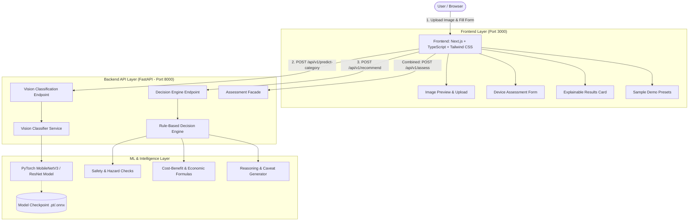
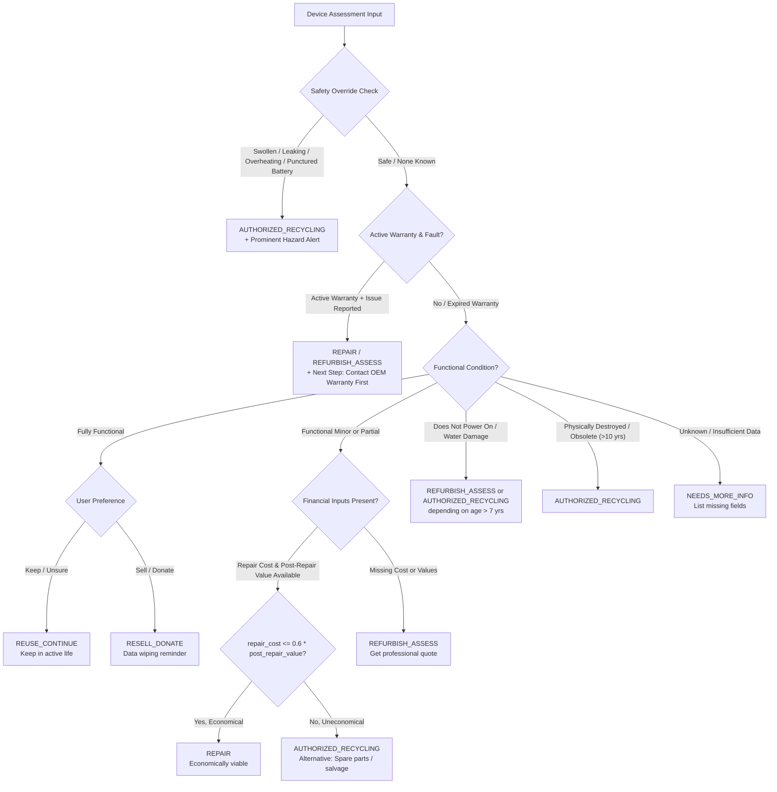

# CircularTech AI — System Architecture & Implementation Plan (`PLAN.md`)

> **Project Title:** CircularTech AI — E-Waste Recovery Intelligence  
> **Tagline:** *Give Every Device a Second Life*  
> **Target Environment:** College AI/ML Hackathon to Production Prototype  
> **Core Principle:** Safety first, explainable recommendations, honest AI (no unsubstantiated diagnostic claims).

---

## 1. Executive Summary & Vision

Electronic waste (e-waste) is one of the fastest-growing solid waste streams globally. Millions of devices are discarded prematurely despite having significant remaining useful life or salvageable components. Conversely, severely damaged or hazardous devices (such as swollen lithium-ion batteries) are frequently handled improperly, posing fire and toxicity hazards.

**CircularTech AI** bridges this decision gap through an intelligent, transparent decision-support system:
1. **Visual Device Categorization:** Computer vision identifies the broad device class from an image (with obligatory human verification).
2. **Transparent Decision Engine:** A deterministic, explainable expert engine weighs device age, functional status, battery health, remaining warranty, and repair economics to recommend the optimal recovery pathway.
3. **Safety & Hazard Guards:** Hazardous battery states override standard recovery pathways immediately with clear handling advisories.
4. **Actionable Recovery Pathways:** Recommends one of 6 clear pathways:
   - *Reuse / Continue Using*
   - *Repair*
   - *Refurbish / Professionally Assess*
   - *Resell / Donate*
   - *Authorized Recycling*
   - *Needs More Information*

---

## 2. System Architecture & Tech Stack



### Technology Stack Justification
| Layer | Choice | Rationale |
|---|---|---|
| **Frontend** | **Next.js 14+ (App Router), TypeScript, Tailwind CSS, Lucide React** | Fast responsive UI, strong type-safety, rapid component iteration during hackathons, rich visual aesthetics. |
| **Backend API** | **FastAPI (Python 3.10+)** | Native async support, automatic OpenAPI/Swagger docs, seamless integration with PyTorch/Pydantic models. |
| **Validation** | **Pydantic v2** | Strict validation of numeric ranges, enums, optional fields, and missing-value isolation (no silent zeros). |
| **ML Engine** | **PyTorch & torchvision (MobileNetV3-Small / ResNet18)** | Lightweight memory footprint, high inference speed on CPU/Mac without requiring a GPU cluster. |
| **Testing** | **pytest (Backend) + Vitest/Jest (Frontend)** | 100% coverage on critical recovery and battery safety decision logic. |

---

## 3. Data Model & Schema Contracts

### 3.1 Enumerations
- **`DeviceCategory`**: `phone`, `laptop`, `tablet`, `monitor`, `tv`, `desktop`, `printer`, `charger_cable`, `battery`, `circuit_board`, `other`
- **`FunctionalCondition`**: `fully_functional`, `functional_minor_issues`, `partially_functional`, `does_not_power_on`, `physically_damaged`, `unknown_not_tested`
- **`BatteryCondition`**: `good`, `degraded`, `swollen_damaged`, `not_applicable`, `unknown`
- **`BatterySafetyConcern`**: `swollen`, `leaking`, `overheating`, `punctured`, `none_known`, `unknown`
- **`WarrantyStatus`**: `active`, `expired`, `unknown`
- **`UserPreference`**: `keep_repair`, `sell_donate`, `recycle`, `unsure`
- **`RecoveryPathway`**: 
  - `REUSE_CONTINUE` (Reuse / Continue using)
  - `REPAIR` (Repair)
  - `REFURBISH_ASSESS` (Refurbish / Professionally assess)
  - `RESELL_DONATE` (Resell / Donate)
  - `AUTHORIZED_RECYCLING` (Authorized recycling)
  - `NEEDS_MORE_INFO` (Needs more information)

### 3.2 Pydantic Data Schemas (`backend/app/schemas.py`)

```python
class BatteryAssessment(BaseModel):
    health_percentage: Optional[int] = Field(None, ge=0, le=100, description="Battery health percentage (0-100)")
    condition: BatteryCondition = BatteryCondition.unknown
    safety_concern: BatterySafetyConcern = BatterySafetyConcern.none_known
    replaceable: Optional[bool] = None
    replacement_cost: Optional[float] = Field(None, ge=0)

class EconomicMetrics(BaseModel):
    estimated_repair_cost: Optional[float] = Field(None, ge=0)
    estimated_post_repair_value: Optional[float] = Field(None, ge=0)
    estimated_current_resale_value: Optional[float] = Field(None, ge=0)
    replacement_cost_equivalent: Optional[float] = Field(None, ge=0)
    currency: str = "INR"

class DeviceAssessmentInput(BaseModel):
    category: DeviceCategory
    category_confirmed_by_user: bool = True
    brand: Optional[str] = None
    model_name: Optional[str] = None
    purchase_year: Optional[int] = None
    device_age_years: Optional[float] = Field(None, ge=0)
    functional_condition: FunctionalCondition
    screen_condition: Optional[str] = "unknown"
    water_damage: Optional[bool] = None
    powers_on: Optional[bool] = None
    battery: BatteryAssessment = Field(default_factory=BatteryAssessment)
    warranty_status: WarrantyStatus = WarrantyStatus.unknown
    warranty_remaining_months: Optional[int] = Field(None, ge=0)
    economics: EconomicMetrics = Field(default_factory=EconomicMetrics)
    user_preference: UserPreference = UserPreference.unsure
    has_personal_data: Optional[bool] = None

class FinancialSummary(BaseModel):
    net_value_after_repair: Optional[float] = None
    repair_cost_ratio: Optional[float] = None
    is_financially_viable: Optional[bool] = None
    currency: str = "INR"

class RecommendationOutput(BaseModel):
    pathway: RecoveryPathway
    headline: str
    explanation: str
    reasons: list[str]
    warnings: list[str]
    safety_alert: Optional[str] = None
    missing_information: list[str]
    next_steps: list[str]
    alternative_pathway: Optional[RecoveryPathway] = None
    financial_summary: Optional[FinancialSummary] = None
    decision_version: str = "1.0.0"

class CategoryPredictionOutput(BaseModel):
    predicted_category: DeviceCategory
    confidence: float
    model_name: str
    model_version: str
    top_candidates: list[dict[str, Any]]
    needs_user_confirmation: bool = True
```

---

## 4. Decision Engine Algorithm Hierarchy

The recovery decision engine (`backend/app/services/decision_engine.py`) follows a strict priority cascade:



### Key Logic Rules & Heuristics
1. **Safety Override (Rule 0):** If `battery.safety_concern` is in `{swollen, leaking, overheating, punctured}` or `battery.condition == swollen_damaged`:
   - Enforce `AUTHORIZED_RECYCLING` (Special Hazardous Handling).
   - Flag high-urgency safety banner: *"Do not attempt home repair, disassembly, or charging. Keep in fire-safe container and take to authorized e-waste/battery collector."*
   - Suppress standard resale/reuse recommendations.
2. **Missing Values Rule:** Never substitute missing economic or age values with zero. If `estimated_repair_cost` is null, do not evaluate `repair_cost_ratio`; prompt user for quote.
3. **Warranty Priority (Rule 1):** If `warranty_status == active` and condition has faults, flag manufacturer repair before paying independent repair fees.
4. **Economic Viability Threshold:** Configurable parameter (default: `repair_cost <= 0.60 * estimated_post_repair_value`).

---

## 5. Machine Learning Vision Pipeline

### 5.1 Dataset Strategy
- **Primary Source Candidate:** E-Tadweer Image Dataset (ETID) — 6,269 images across 7 classes: `battery`, `cable`, `keyboard`, `laptop`, `mobile_phone`, `mouse`, `printed_circuit_board`.
- **User-Provided Dataset:** Modular dataset loader will support custom folders structured as:
  ```text
  datasets/
  ├── train/
  │   ├── phone/
  │   ├── laptop/
  │   └── ...
  ├── val/
  └── test/
  ```
- **Fallback / Standalone Mode:** Pretrained MobileNetV3 with ImageNet weights mapped to target e-waste synsets, so the application runs immediately without requiring a lengthy training run.

### 5.2 Training & Evaluation Pipeline
```text
scripts/
├── train_classifier.py    # PyTorch training loop with data augmentation (flips, color jitter)
├── evaluate_model.py      # Computes per-class Precision, Recall, F1, and Confusion Matrix
└── export_model.py        # Exports model to lightweight TorchScript / ONNX format
```

### 5.3 Vision Model Safeguards
- Top-1 and Top-3 category predictions with confidence scores.
- If Top-1 confidence is `< 0.60`, flag `needs_user_confirmation = true` and prompt user to select from top-3 suggestions.
- **Explicit UX Disclaimer:** *"AI identifies device physical category only. It cannot detect internal motherboard faults, chip damage, or battery degradation from a photo."*

---

## 6. Frontend UI / UX Specification

### Page Flows & Component Breakdown
```text
frontend/src/
├── app/
│   ├── page.tsx                    # Landing hero + Problem/Solution + Quick CTA
│   ├── assess/
│   │   └── page.tsx                # Interactive 3-step Assessment Form
│   ├── results/
│   │   └── page.tsx                # Detailed Explainable Pathway Card + Recalculate
│   └── layout.tsx                  # Header, Footer, Theme provider
├── components/
│   ├── assessment/
│   │   ├── ImageUploader.tsx       # Drag-and-drop, camera capture, instant preview
│   │   ├── CategorySelector.tsx    # AI-predicted badge + human override pills
│   │   ├── FunctionalForm.tsx      # Condition, powers on, screen, water damage
│   │   ├── BatteryForm.tsx         # Battery health %, condition, hazard checkboxes
│   │   ├── EconomicsForm.tsx       # Currency (₹/$/€), repair estimate, resale estimate
│   │   └── PresetLoader.tsx        # One-click demo test scenarios
│   ├── results/
│   │   ├── PathwayBadge.tsx        # Color-coded badge (Green=Reuse, Amber=Repair, Red=Hazard)
│   │   ├── SafetyAlertBanner.tsx   # Unmissable warning for swollen/hazardous batteries
│   │   ├── ReasonList.tsx          # Clear transparent bullet points
│   │   ├── FinancialBreakdown.tsx  # Cost vs. Value bar/gauge comparison
│   │   └── NextStepsChecklist.tsx  # Step-by-step guidance (Data wiping, Authorized recyclers)
│   └── ui/                         # Modern sleek cards, buttons, modals, badges
```

### Design Aesthetics & Theming
- **Palette:** Eco-tech aesthetic with slate dark/light contrast (`#0f172a` slate-900, `#059669` emerald-600 for positive recovery, `#d97706` amber-500 for repair, `#dc2626` rose-600 for safety alerts).
- **Typography:** Inter or Outfit from Google Fonts.
- **Responsiveness:** Seamless on mobile devices (for users photographing broken electronics on their phone) and desktop.

---

## 7. Step-by-Step Implementation Roadmap

### Phase 1: Project Scaffolding & Shared Types
- [ ] Initialize monorepo directory layout (`frontend/`, `backend/`, `datasets/`, `docs/`).
- [ ] Configure Python virtual environment and `backend/requirements.txt` (`fastapi`, `uvicorn`, `pydantic`, `torch`, `torchvision`, `pillow`, `pytest`, `python-multipart`).
- [ ] Initialize Next.js project with TypeScript, Tailwind CSS, Lucide icons.
- [ ] Implement shared Pydantic data schemas in `backend/app/schemas.py`.

### Phase 2: Core Decision Engine & Safety Hierarchy
- [ ] Implement `backend/app/services/decision_engine.py` with strict priority cascade:
  1. Battery safety hazard override.
  2. Active warranty fault routing.
  3. Functional condition branching (reuse vs resell).
  4. Economic viability analysis (`repair_cost_ratio <= 0.60`).
  5. Age & obsolescence checks.
  6. Missing-data handling.
- [ ] Write comprehensive unit tests in `backend/tests/test_decision_engine.py` covering all 8 manual test cases:
  1. Fully working laptop.
  2. Economically repairable phone with quote.
  3. Uneconomic repair (repair > value).
  4. Non-powering device without quote.
  5. Active warranty claim.
  6. Swollen/hazardous battery override.
  7. Partial data / missing financial metrics.
  8. Obsolete device (>10 years old).

### Phase 3: Vision Classifier Module
- [ ] Build `backend/app/services/classifier.py` using PyTorch MobileNetV3.
- [ ] Support both:
  - Default out-of-the-box pretrained weights with label mapping.
  - Fine-tuned weights loader if dataset is trained.
- [ ] Add category prediction endpoint `POST /api/v1/predict-category` with image validation and file-size guard (< 10MB).
- [ ] Build `POST /api/v1/recommend` and combined `POST /api/v1/assess`.

### Phase 4: Frontend Development
- [ ] Create sleek responsive Home / Landing page with hero, mission overview, and CTA.
- [ ] Build Assessment Form with image upload, live camera/file preview, and auto-classification trigger.
- [ ] Implement category confirmation (allowing user to override AI suggestion).
- [ ] Implement progressive form disclosure:
  - Basic condition.
  - Battery details with real-time hazard warnings.
  - Optional economics (estimates).
- [ ] Build 4 quick-load Demo Presets (*"Pristine Laptop"*, *"Cracked Screen Phone"*, *"Swollen Battery Tablet"*, *"Water Damaged Old Desktop"*).

### Phase 5: Results View & Transparency Features
- [ ] Build Results screen:
  - Pathway card with distinct visual colorway.
  - Clear explanations and bulleted reasoning.
  - Financial viability graph / breakdown (if data supplied).
  - Safety hazard alert box (when applicable).
  - Data privacy checklist (*"Backup files, log out of iCloud/Google, perform factory reset"*).
  - Authorized recycler locator / action checklist.
- [ ] Allow "Edit Inputs & Recalculate" to instantly tune values.

### Phase 6: Dataset Ingestion & Evaluation (When dataset is provided)
- [ ] Create ingestion script `scripts/prepare_dataset.py` to format images into standard PyTorch ImageFolder format.
- [ ] Provide fine-tuning script `scripts/train.py` with training loss/accuracy metrics.
- [ ] Generate confusion matrix and class report in `docs/evaluation.md`.

### Phase 7: Verification, Documentation & Demo Prep
- [ ] Execute test suite (`pytest` passes 100%).
- [ ] Verify frontend build (`npm run build`).
- [ ] Complete `README.md` with quick-start instructions, architecture diagram, and hackathon presentation talking points.

---

## 8. Test Cases & Verification Matrix

| # | Test Scenario | Input Highlights | Expected Pathway | Expected Warnings / Highlights |
|---|---|---|---|---|
| 1 | **Functional Laptop** | 3 yrs old, Fully functional, Battery 85%, No faults | `REUSE_CONTINUE` | Encourage continued use; clean dust & maintain OS |
| 2 | **Viable Repair** | Phone, screen cracked, Repair ₹2,000, Resale ₹6,500 | `REPAIR` | Economically viable (30.7% cost ratio); show ₹4,500 net value |
| 3 | **Uneconomic Repair** | Old Monitor, Repair ₹3,000, Value ₹2,000 | `AUTHORIZED_RECYCLING` | Repair exceeds value; recommend salvage or authorized recycler |
| 4 | **Swollen Battery Hazard** | Tablet, Battery swollen/leaking, Condition unknown | `AUTHORIZED_RECYCLING` | **CRITICAL SAFETY ALERT**: Do not charge/open; take to hazardous depot |
| 5 | **Active Warranty** | Laptop, 6 months warranty left, screen flickering | `REPAIR` / `REFURBISH_ASSESS` | Check OEM warranty claim first before paying third-party |
| 6 | **Unknown / No Power** | Desktop, does not power on, no quotes entered | `REFURBISH_ASSESS` | Recommend diagnostic check; highlight missing repair quote |
| 7 | **Obsolete Hardware** | PC from 2008 (16+ yrs old), defective | `AUTHORIZED_RECYCLING` | Hardware obsolete for modern software; material recovery route |
| 8 | **Personal Data Safety** | Phone, working, user chose "Sell/Donate" | `RESELL_DONATE` | Prominent checklist: Remote logout, factory reset, SIM/SD removal |

---

## 9. Key Technical & Domain Questions for the User

To tailor the dataset ingestion and fine-tuning pipeline to your exact specifications, please clarify:
1. **Dataset Format & Categories:** What format is your dataset in (e.g. ZIP archive, folder per class, CSV annotations), and what exact classes/categories does it contain?
2. **Model Training Resource:** Will the model training be run locally on this Mac, or would you prefer a lightweight pre-trained model with fast inference on CPU?
3. **Currency & Localization:** Is INR (₹) the preferred default currency, and are there specific regional e-waste guidelines (e.g. India CPCB / E-Waste Management Rules) you'd like highlighted?
4. **Starter Preference:** Would you like us to proceed immediately with creating the complete working MVP code (Backend FastAPI engine + Frontend Next.js app + unit tests)?
